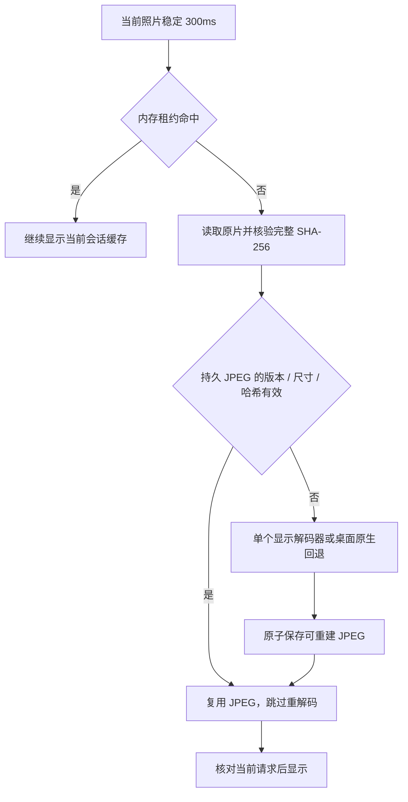

# 分层显示、持久缓存与原生格式回退

此说明对应融合开发分支，原查看器和配色保持。清晰度只影响查看，不替换编辑工程、水印或导出的来源。

## 三层显示

| 层级 | 行为 |
| --- | --- |
| 标准预览 | 桌面保留 2560px / 560px 派生图；独立浏览器沿用自己的标准尺寸 |
| 当前照片高清 | 宽屏选择 4096 / 6144，稳定停留 300ms 后处理；小图不放大 |
| 持久显示 JPEG | 本地浏览器配置中的可重建缓存，跨页面重载保留，减少重复重解码 |

JPEG、PNG、WebP、AVIF 和 RAW 继续使用既有显示 Worker。RAW 仍用 LibRaw-WASM 1.6.0 全量 16 位线性解码，最后显示为 8 位 JPEG；不是放大相机内嵌小图。桌面 TIFF / HEIC / HEIF 使用已有 Pillow / HEIF 能力的全尺寸回退，处理 EXIF 方向、ICC 到 sRGB、透明度和缩小；16 位灰度按完整灰阶映射。独立浏览器不会向桌面服务发送这些文件请求，其格式边界保持。

命中持久缓存仍会读取原片并校验完整哈希，减少的是重复解码，不是完全消除磁盘读取。原片不匹配或不可访问时不以旧持久缓存替代检查。已有会话内存命中按登记哈希使用；外部目录持续监听和文件位置管理仍属于后续功能。

## 缓存预算与身份

高清内存池仍只保留压缩 JPEG：单重解码、最多 12 项 / 48 MiB 空闲缓存，在用租约受保护；两侧邻图只延迟预读标准图，不自动显影相邻 RAW。

持久缓存在当前应用的本地 IndexedDB，独立于离线应用的 CacheStorage，也不写入源照片目录。它在同一应用来源的全部图库间合计最多 64 项 / 256 MiB JPEG 字节，按最近使用和字节数淘汰；单文件最多 64 MiB。该数值不含数据库自身开销、浏览器位图、GPU 或进程内存，不能当作设备峰值预算。

缓存键包含图库 UUID、源照片 ID、完整源哈希、档位、渲染算法 / 解码版本和底色。RAW / 普通 Worker 键包含 kernel 和 LibRaw 版本；桌面回退包含实际 Pillow / HEIF 版本。缓存中没有原片、文件路径、EXIF、工程、密钥或会话凭证。JPEG 与元数据在同一事务提交，损坏的 JPEG 会重新生成；配额、权限和不支持的存储环境不会使有效高清图无法显示。

设置中的“高清显示缓存”仅列当前库的数量和 JPEG 字节，可清理当前库。清理、LRU 淘汰或浏览器清除网站数据都不删除原片、标准预览、编辑工程、草稿、海报或导出，也不撤销另一窗口正在显示的 Blob。库备份不需要包含这类可重建缓存；恢复库后可重新生成。

## 桌面回退和取消

原生 TIFF / HEIF 在可终止子进程中解码，复用现有依赖，不启动 AI。它与导出 / 导入共享后端渲染额度，已排队的导出先取得名额，当前显示优先于后台导入预览；等待和运行都可取消，不生成计费请求或历史任务根。

API 只接收已登记照片 ID、源哈希和档位，不接受任意文件路径。原片在解码前后重新核验哈希和状态；临时输出仅在托管预览工作目录，验证后返回，完成 / 取消后清理。限制为输入 256 MiB、1 亿像素、输出 64 MiB、最长 180 秒。关闭或切图取消 HTTP 需求，正在解码的进程终止后才释放渲染名额。

失败保留标准预览，沿用本地重试入口；收藏或元数据更新不会自动重试坏源。本文描述的是显示路径，不承诺所有 TIFF 色彩模式、RAW 相机或打印 ICC 软打样都已通过真实设备验证。高清 JPEG 为 8 位 sRGB，编辑与导出仍使用各自真实源。

## 验证范围

相关检查覆盖真实 TIFF / HEIF 全尺寸与方向、透明度、小图不放大、16 位灰度、子进程取消与共享队列、解码中原片变化、HTTP 断开、持久命中 / 损坏重建、源变化拒绝、事务失败回滚、跨库 LRU、另一个窗口的活跃图片和导出哈希、存储不可用提示。最终完整结果见[融合实施记录](afterframe-upgrade.md)。Windows WebView、硬件峰值和发行包仍归 M7 验收。

## 无 EXIF 的 JPEG 方向兼容

桌面既有 Pillow 标准预览可能从嵌入 XMP 读取方向。高清 Worker 对没有显式 EXIF Orientation 的 JPEG 补充同一旋转；有显式 EXIF 时保持浏览器已经执行的变换，避免旋转两次。PNG、RAW 和原生 TIFF / HEIF 回退继续各自原有路径，旧 v1 编辑源解码不随此次显示修复改变。

桌面 Worker 的持久缓存算法标识包含 `native-orientation-1-white`，旧缓存不能误作修复后的结果。合成四角色块检查标准 / 高清的宽高和实际颜色位置，并核对原片 SHA-256；只比较宽高不足以排除拉伸或重复旋转。

独立浏览器的新图库来源也保存方向规则；标准与高清读取同一规则。内存请求键包含规则对象，持久算法名区分 `browser-source-v2-<方向>-black`，旧来源继续原来的键与像素。规则与实际照片不一致则拒绝处理，不借用其他规则的缓存。图库格式升级与旧草稿 / 工程的回放见 [编辑源解码版本](source-decoding.md)。
